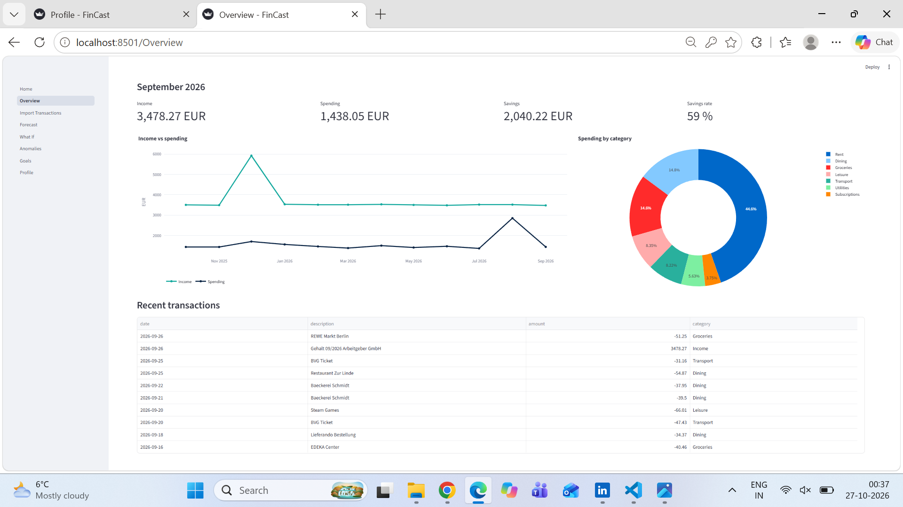
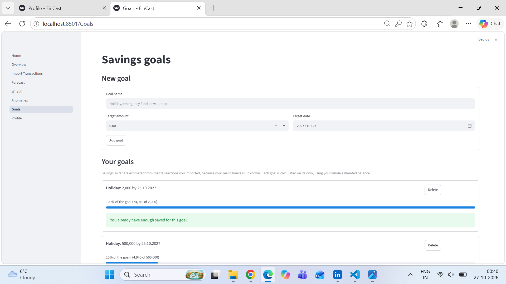
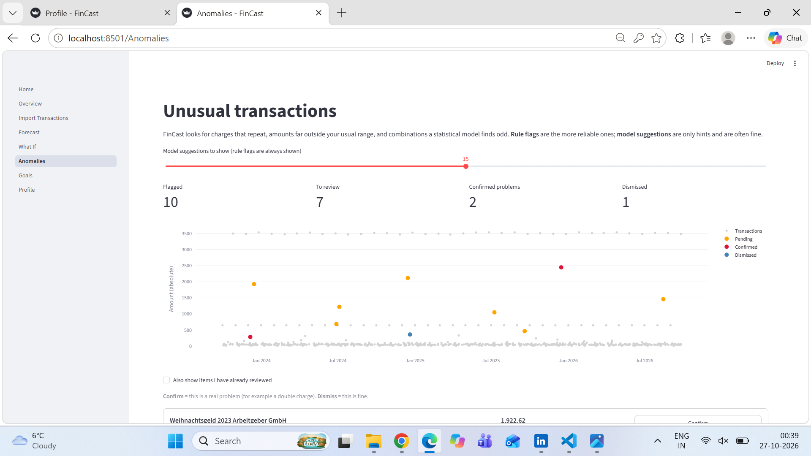
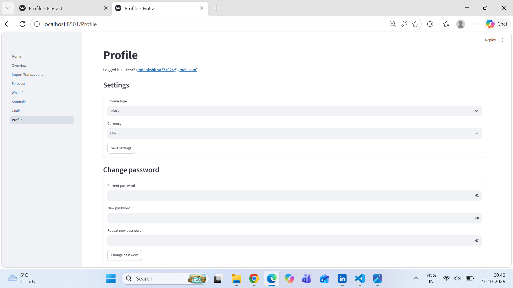

# FinCast

FinCast is a personal finance app. You import your bank transactions as a CSV, and it:

- sorts them into categories automatically,
- forecasts next month's income, spending and end balance, with a likely range,
- flags unusual transactions (for example a possible double charge),
- tracks savings goals and shows how a change in spending would affect your savings.

## Results

All numbers come from a 12-month rolling backtest on synthetic data (300 users).

| Test | Model | Baseline (same month last year) |
|---|---|---|
| Variable spending, MAE (seen users) | 53.76 | 65.56 |
| Variable spending, MAE (new users) | 52.64 | 62.81 |
| Users with under 12 months of history | 61.59 | 65.56 |

- The model must beat the baseline by at least 10% to be used. It does, in both tests.
- The 80% forecast range covers the real value about 83% of the time.
- Rent and subscriptions are copied from last month, because they do not change.


Register an account, then upload a bank CSV on the Import page. A sample file is in `data/sample/`.


Commit the code and the retrained files in `models/` together, so they always agree.

## Known limits

- The models are trained on synthetic data. Real bank data may behave differently.
- Savings so far are estimated from the imported transactions, because the real balance is unknown.
- The 61.59 result for short histories is a best case: that test only fills the missing "same month last year" value.
- The currency setting is saved but not yet used for number formatting.
- Forecasts are for education only, not financial advice.

## Commands

Run the app:

```
pip install -r requirements.txt
streamlit run dashboard/Home.py
```

Retrain the models and run the tests:

```
python -m src.training.train_forecaster
python -m pytest tests -q
```

## Screenshots

### Overview


### Forecast


### What If


### Anomalies


### Goals


### Import


### More screenshots

#### Home


#### Forecast, by category


#### Anomalies, before review


#### Profile


### More screenshots

#### Home


#### Forecast, by category


#### Anomalies, before review


#### Profile


